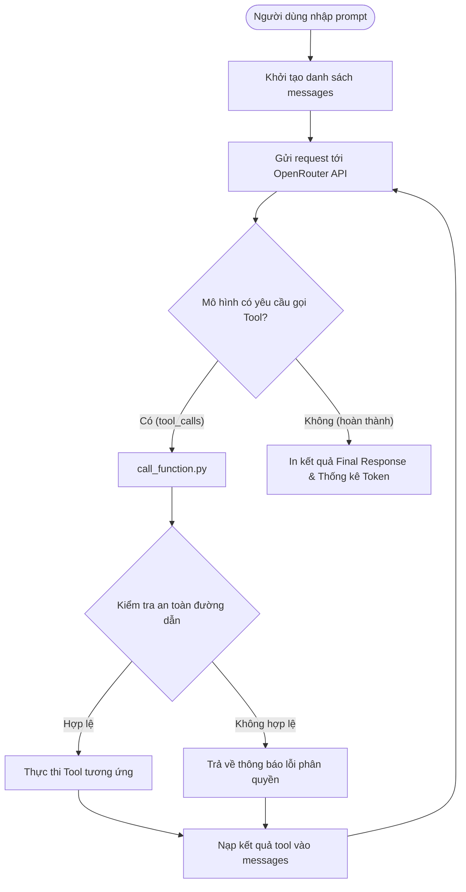

# 🤖 myAgent - Autonomous AI Coding Agent

**myAgent** là một trợ lý lập trình thông minh (AI Coding Agent) được xây dựng trên nền tảng **Python**, kết nối với mô hình ngôn ngữ lớn (LLM) qua **OpenRouter / OpenAI API**. Agent có khả năng tự động lên kế hoạch (Planning), khám phá cấu trúc mã nguồn, đọc/ghi tệp tin và thực thi mã Python theo mô hình vòng lặp **ReAct (Reason + Act)**.

---

## Tính năng nổi bật

- **Vòng lặp ReAct tự chủ (Autonomous Agentic Loop):** Tự động phân tích yêu cầu của người dùng, gọi các công cụ (tools) cần thiết, nhận kết quả và lặp lại cho đến khi hoàn thành mục tiêu (tối đa `MAX_ITERS` vòng lặp).
- **Hệ thống Tool Calling linh hoạt:**
  - `get_files_info`: Khám phá danh sách tệp tin, kích thước (bytes) và phân biệt thư mục/file.
  - `get_file_content`: Đọc nội dung tệp tin an toàn (có giới hạn độ dài ký tự tránh tràn ngữ cảnh).
  - `write_file`: Tạo mới hoặc ghi đè nội dung file, tự động tạo thư mục cha nếu chưa có.
  - `run_python_file`: Thực thi script Python trong môi trường con độc lập (`subprocess`), thu thập cả `STDOUT` và `STDERR`.
- **Cơ chế bảo mật đường dẫn (Path Security Sandbox):** Sử dụng `os.path.commonpath` để kiểm tra và ngăn chặn tấn công Directory Traversal (Path Traversal), đảm bảo Agent chỉ thao tác bên trong thư mục được cho phép (`WORKING_DIR`).
- **Theo dõi chi phí Token:** Tích lũy và in ra chính xác số lượng `prompt_tokens` và `response_tokens` tiêu tốn qua toàn bộ các vòng lặp.

---

## Cấu trúc dự án

```text
myAgent/
├── calculator/                   # Thư mục làm việc (Workspace mục tiêu cho Agent)
│   ├── main.py                   # Ứng dụng tính toán dòng lệnh
│   ├── tests.py                  # Bộ kiểm thử cho calculator
│   └── pkg/                      # Các module phụ trợ (calculator, render)
├── functions/                    # Các công cụ (Tools) mà Agent có thể sử dụng
│   ├── get_files_info.py         # Tool liệt kê file/folder
│   ├── get_file_content.py       # Tool đọc nội dung file
│   ├── write_file.py             # Tool ghi/tạo file
│   └── run_python_file.py        # Tool thực thi mã Python
├── call_function.py              # Điều phối gọi hàm và inject working_directory
├── config.py                     # Thiết lập cấu hình (MAX_ITERS, MAX_CHARS, WORKING_DIR)
├── prompts.py                    # System prompt định nghĩa vai trò Agent
├── main.py                       # Điểm khởi chạy chương trình (CLI Entry Point)
├── pyproject.toml                # Thông tin dự án và danh sách dependencies
└── README.md                     # Tài liệu hướng dẫn sử dụng
```

---

## Yêu cầu hệ thống

- **Python:** `>= 3.10`
- **Khóa API OpenRouter:** Cần có tài khoản tại [openrouter.ai](https://openrouter.ai) (sử dụng được các model miễn phí hoặc có phí).

---

## Cài đặt

1. **Clone hoặc mở dự án:**
   ```bash
   cd /home/tuanle/projects/myAgent
   ```

2. **Tạo môi trường ảo (khuyến nghị):**
   ```bash
   python3 -m venv .venv
   source .venv/bin/activate
   ```

3. **Cài đặt các thư viện cần thiết:**
   ```bash
   pip install openai python-dotenv
   ```

4. **Cấu hình biến môi trường:**
   Tạo file `.env` tại thư mục gốc của dự án với nội dung:
   ```env
   OPENROUTER_API_KEY="your_openrouter_api_key_here"
   ```

---

## Hướng dẫn sử dụng

### 1. Cú pháp cơ bản
```bash
python main.py "<câu_lệnh_của_bạn>"
```

### 2. Chế độ chi tiết (`--verbose`)
Thêm cờ `--verbose` để theo dõi toàn bộ quá trình suy nghĩ, các lượt gọi tool và kết quả trung gian:
```bash
python main.py "<câu_lệnh_của_bạn>" --verbose
```

### 3. Ví dụ thực tế

- **Khám phá và tính toán:**
  ```bash
  python main.py "Hãy kiểm tra thư mục calculator và tính toán biểu thức 15 * 4" --verbose
  ```
- **Chạy kiểm thử:**
  ```bash
  python main.py "Chạy bộ kiểm thử tests.py trong calculator và thông báo kết quả" --verbose
  ```
- **Tạo hoặc sửa file:**
  ```bash
  python main.py "Viết một hàm tính giai thừa vào file calculator/pkg/factorial.py" --verbose
  ```

---

## Luồng hoạt động (Workflow)



---

## Tùy chỉnh nâng cao trong `config.py`

| Tham số | Giá trị mặc định | Giải thích |
| :--- | :---: | :--- |
| `WORKING_DIR` | `"./calculator"` | Thư mục làm việc mà Agent được cấp quyền truy cập |
| `MAX_ITERS` | `20` | Giới hạn số vòng lặp tối đa để tránh vòng lặp vô tận |
| `MAX_CHARS` | `10000` | Số lượng ký tự tối đa đọc từ mỗi file để tiết kiệm token |
